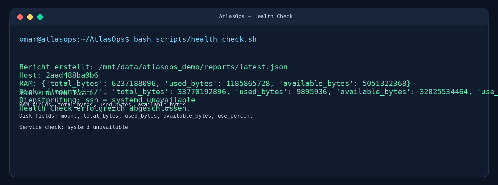
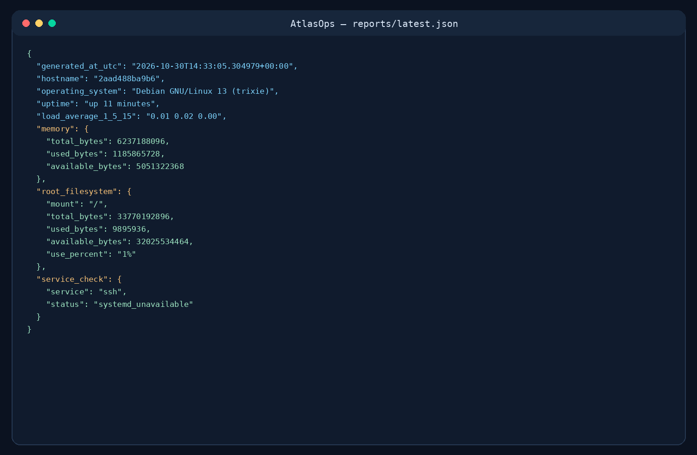
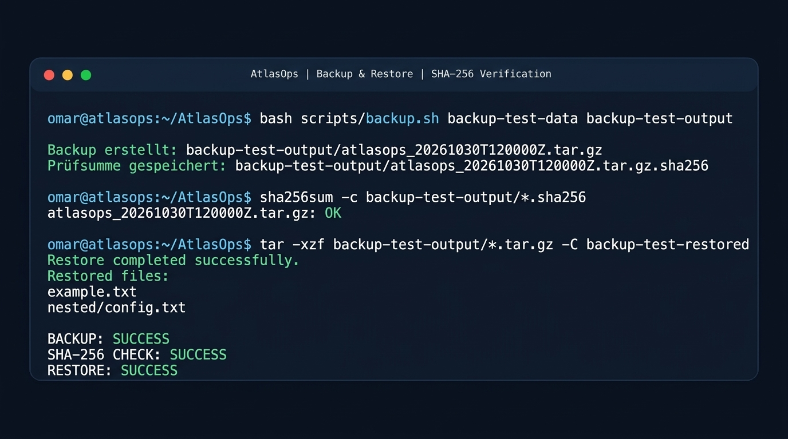
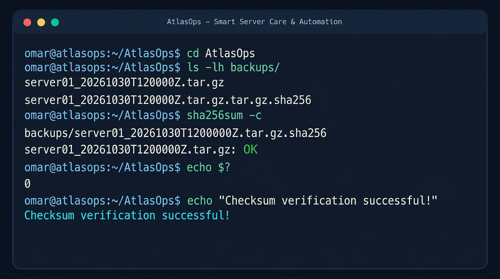

<h1 align="center">AtlasOps</h1>

<h3 align="center">Smart Server Care & Automation</h3>

<p align="center">
  Linux System Administration | Monitoring | Backup Automation
</p>

<p align="center">
  
  
  
  
  
</p>

<p align="center">
  <strong>Portfolio-Projekt für Fachinformatiker/in für Systemintegration</strong>
</p>

---

<p align="center">
  
</p>

---

## Projektübersicht

AtlasOps ist ein praxisorientiertes Portfolio-Projekt im Bereich Linux-Systemadministration und IT-Automatisierung.

Das Projekt simuliert typische administrative Aufgaben in einem kleinen Unternehmen mit Linux-Systemen. Ziel ist es, wiederkehrende Aufgaben durch Bash-Skripte zu vereinfachen, Systeminformationen strukturiert zu erfassen und Backups mit SHA-256-Prüfsummen zu erstellen.

**Projektstatus:** Lern- und Lab-Projekt. Die Skripte müssen in einer geeigneten Linux-Testumgebung geprüft werden, bevor sie für produktive Systeme verwendet werden.

## Funktionen

- Systeminformationen eines Linux-Systems erfassen
- Systemzustand in einem JSON-Bericht speichern
- JSON-Berichte mit Python lesbar ausgeben
- Verzeichnisse als komprimierte Backups sichern
- SHA-256-Prüfsummen für Backup-Dateien erstellen
- Typische administrative Aufgaben mit Bash automatisieren
- Ergebnisse und Tests strukturiert dokumentieren

## Technologien

- **Linux** – Grundlagen der Systemadministration
- **Bash** – Automatisierung administrativer Aufgaben
- **Python 3** – Verarbeitung und Darstellung von JSON-Daten
- **Git & GitHub** – Versionsverwaltung und Projektdokumentation
- **JSON** – Strukturierte Speicherung von Systeminformationen
- **SHA-256** – Überprüfung der Integrität von Backup-Dateien

## Projektstruktur

```text
AtlasOps/
├── assets/
│   ├── banner.png.jpg
│   └── screenshots/
│       ├── 01-health-check.png
│       ├── 02-json-report.png
│       ├── 03-backup-restore.png
│       └── 04-checksum-verification.png
├── scripts/
│   └── health_check.sh
├── backup.sh
├── report.py
├── reports/
├── README.md
├── ARCHITECTURE.md
└── TESTPLAN.md
```

## Voraussetzungen

Für die Ausführung werden folgende Komponenten benötigt:

- Linux-System oder Ubuntu-VM
- Bash
- Python 3
- Übliche Linux-Werkzeuge wie `tar`, `sha256sum` und `realpath`

Die verfügbaren Werkzeuge können je nach Linux-Distribution variieren.

## Installation und Schnellstart

### 1. Repository klonen

```bash
git clone https://github.com/Omar-Bahma-sysadmin/AtlasOps.git
cd AtlasOps
```

### 2. Skripte ausführbar machen

```bash
chmod +x scripts/health_check.sh
chmod +x backup.sh
```

### 3. System-Health-Check ausführen

```bash
./scripts/health_check.sh
```

Das Skript erfasst ausgewählte Systeminformationen und speichert den Bericht unter:

```text
reports/latest.json
```

### 4. Systembericht anzeigen

```bash
python3 report.py --input reports/latest.json
```

Das Python-Skript liest den JSON-Bericht und stellt die enthaltenen Informationen in einer übersichtlichen Textausgabe dar.

## Backup erstellen

Für einen ersten Test können eigene Testdaten erstellt werden:

```bash
mkdir -p /tmp/atlasops-demo/source
echo "Testdaten" > /tmp/atlasops-demo/source/demo.txt
```

Anschließend kann ein Backup erstellt werden:

```bash
./backup.sh /tmp/atlasops-demo/source /tmp/atlasops-demo/backups
```

Das Skript erstellt ein komprimiertes Archiv und eine zugehörige SHA-256-Prüfsummendatei.

**Wichtig:** Verwende für Tests ausschließlich eigene Testdaten oder Daten, für deren Sicherung du ausdrücklich berechtigt bist.

## Backup überprüfen

Die Integrität eines erstellten Backups kann mit `sha256sum` überprüft werden.

Wechsle in das Verzeichnis, in dem das Backup gespeichert wurde, und führe den folgenden Befehl mit dem tatsächlichen Namen der Prüfsummendatei aus:

```bash
sha256sum -c DATEI.tar.gz.sha256
```

Ersetze `DATEI.tar.gz.sha256` durch den tatsächlichen Dateinamen.

Der Inhalt des Archivs kann außerdem aufgelistet werden:

```bash
tar -tzf DATEI.tar.gz
```

Eine Wiederherstellung sollte zunächst in einem separaten Testverzeichnis durchgeführt werden.

## Sicherheit

- Keine Passwörter, Zugriffstokens, privaten Schlüssel oder vertraulichen Kundendaten in das Repository hochladen.
- Skripte zuerst in einer virtuellen Maschine oder einer isolierten Testumgebung prüfen.
- Für Backups nur geeignete Quell- und Zielverzeichnisse verwenden.
- Prüfsummen nicht mit einer vollständigen Wiederherstellung verwechseln: Sie helfen, Veränderungen an Dateien zu erkennen.
- Die Wiederherstellung von Backups separat testen.
- Vor einem produktiven Einsatz Dateiberechtigungen, Speicherplatz und Aufbewahrungsfristen berücksichtigen.

## Screenshots

Die folgenden Bilder sind **illustrative Darstellungen des vorgesehenen Workflows**. Sie sind keine bestätigten Ergebnisse eines vollständig durchgeführten Tests auf einem realen Linux-Server.

### 1. System Health Check



### 2. JSON System Report



### 3. Backup and Restore



### 4. SHA-256 Checksum Verification



## Tests und Qualitätssicherung

Die automatisierten Integrationstests laufen über **GitHub Actions**. Der erfolgreiche Lauf vom **30.10.2026** wurde auf einem GitHub-gehosteten Runner mit **Ubuntu 24.04.5 LTS** ausgeführt.

**Ergebnis:** Alle zehn Workflow-Schritte wurden erfolgreich abgeschlossen.

Getestet wurden:
- Linux-Umgebung und Verfügbarkeit von systemd
- Installation und Start des OpenSSH-Dienstes
- Erkennung eines aktiven Dienstes sowie eines nicht vorhandenen Dienstes
- Verarbeitung gültiger JSON-Daten mit dem Python-Report-Renderer
- Zurückweisung von fehlerhaftem JSON und JSON-Daten mit falscher Struktur
- Erstellung eines Backup-Archivs und SHA-256-Prüfsumme
- Prüfung der Prüfsumme und Wiederherstellung mit anschließendem Dateivergleich
- Fehlerfälle: fehlende Quelle, verschachteltes Backup-Ziel, ungültiges Ziel und simulierter tar-Fehler

**Nachweise:**
- [Erfolgreicher GitHub-Actions-Lauf](https://github.com/Omar-Bahma-sysadmin/AtlasOps/actions/runs/41091067906)
- [Workflow-Artefakt: atlasops-test-evidence](https://github.com/Omar-Bahma-sysadmin/AtlasOps/actions/runs/41091067906/artifacts/12992903857)

Der Workflow-Artefakt enthält den erzeugten JSON-Testbericht. Die vollständigen Schritt- und Konsolenprotokolle sind im GitHub-Actions-Lauf einsehbar.

**Abgrenzung:** Diese Ergebnisse belegen die automatisierten Tests in der genannten Ubuntu-CI-Umgebung. Sie sind kein Nachweis für einen produktiven Einsatz oder für Tests auf allen Linux-Distributionen. Manuelle Tests in einer eigenen Ubuntu-Server-VM bleiben eine separate Prüfung.

## Roadmap

- [x] Grundstruktur des Projekts erstellen
- [x] Health-Check-Skript entwickeln
- [x] Backup-Skript mit SHA-256-Prüfsumme entwickeln
- [x] Python-Skript zur Darstellung des JSON-Berichts entwickeln
- [x] Projektdokumentation und illustrative Screenshots hinzufügen
- [x] Automatisierte Integrationstests in GitHub Actions erfolgreich ausführen
- [x] Backup-Integrität und Wiederherstellung im CI-Test prüfen
- [x] CI-Testergebnisse dokumentieren
- [ ] Skripte zusätzlich manuell in einer eigenen Ubuntu-Server-VM testen
- [ ] Ansible-Playbook als zukünftige Erweiterung entwickeln und testen
- [ ] Deutsche Projektpräsentation für Bewerbungen vorbereiten

## Lernziele

Mit AtlasOps vertiefe ich meine Kenntnisse in folgenden Bereichen:

- Linux-Systemadministration
- Bash-Scripting und Automatisierung
- Python und JSON
- Backup- und Datenintegritätskonzepte
- Fehleranalyse und systematisches Troubleshooting
- Git, GitHub und technische Dokumentation

## Über das Projekt

AtlasOps ist ein persönliches Lernprojekt, mit dem ich meine praktischen IT-Kenntnisse erweitere und mich auf Aufgaben im Bereich **Fachinformatik für Systemintegration** vorbereite.

Ich möchte damit zeigen, dass ich mich eigenständig mit technischen Problemen auseinandersetze, Lösungen dokumentiere und meine Kenntnisse in der Systemadministration kontinuierlich weiterentwickle.

---

**Repository:** [Omar-Bahma-sysadmin/AtlasOps](https://github.com/Omar-Bahma-sysadmin/AtlasOps)
